# DualVLN VLA-E2E: 자체 데이터셋 · 실험 · 평가

작성일: 2026-10-21 · 대상 릴리스: `dualvln-vla-e2e-20261021-rc3`
(S2 `s2_e2e_v6_bootstrap_robust` + S1 `s1_e2e_v9_endpoint_focus`)

> 요약
> - 자체 수집 차량 데이터 **29 episode, 3,247 프레임(2 Hz), 약 27분, 약 1.3 km**로 사전학습 DualVLN을 도메인 적응했다.
> - S1 궤적: 전체 validation 2,446개에서 mean-trajectory **ADE 0.405 m / FDE 0.739 m**, bearing 10° 이내 **90.9%**.
> - S2 pixel-goal: open-loop median **68.4 px**, STOP 정확도 **100%**, 동일 장면 좌/우 지시 분리 **100%**.
> - 비동기 런타임으로 제어 응답 **p50 363 ms** (2 Hz 충족).
> - **safe_stop(주차 목표 grounding)은 아직 gate 미통과** → shadow mode 전용, 실차 제어 미연결.

## 1. 시스템 개요

| 구성 | 모델 | 입력 | 출력 |
|---|---|---|---|
| S2 (System 2) | Qwen2.5-VL-7B 기반, `s2_e2e_v6_bootstrap_robust` | 지시문 + 명령, 전방 history 최대 8장, 현재 전방, 현재 look-down(전방 하단 crop), safe_stop 시 이전 look-down·이전 goal | look-down 좌표계 pixel-goal `"u v"` 또는 `STOP` |
| S1 (System 1) | InternVLA-N1 `nextdit_async` diffusion, `s1_e2e_v9_endpoint_focus` | goal 텍스트(S1 tokenizer로 재토큰화) + 전방·look-down | ego-local 궤적 후보 4개, 4점 `[x, y, θ]` (전진 = −y) |

명령 체계: `follow`, `turn_left`, `turn_right`, `safe_stop`(검수된 주차면 설명으로 목표 지정, `park_forward` 궤적), `stop`(S1 우회, discrete stop).

## 2. 자체 데이터셋 (VLA-E2E)

### 2.1 수집

- 차량 전방 카메라 1920×1080(왜곡 보정, `undistort_orin_pc_*`), 전방 depth, ego pose(x, y, θ, 속도, 조향), 경로 명령, 6개 카메라 보정 정보.
- 기록 주기 **2 Hz(0.5 s/프레임)**.
- 수집 세션: 2026-05-15, 05-19, 05-21 일반 주행 + 05-19 `park_forward` 주차 주행. 원본 디렉터리 43개(8.6 GB) 중 episode 이름 기준 **29개** 사용.
- 장소: 사내 주차장/구내 도로(평탄 포장, 주차면, 건물·텐트·화단 등 랜드마크).

### 2.2 규모

| Split | 유형 | Episode | 프레임 | 시간 | 주행 거리 |
|---|---|---:|---:|---:|---:|
| Train | 일반 주행 | 9 | 1,532 | 12.7 분 | 782 m |
| Train | 주차(park_forward) | 13 | 745 | 6.1 분 | 115 m |
| Val | 일반 주행 | 4 | 760 | 6.3 분 | 379 m |
| Val | 주차(park_forward) | 3 | 210 | 1.7 분 | 34 m |
| **합계** | | **29** | **3,247** | **26.8 분** | **1.31 km** |

- Train/Val은 **episode 단위 분리**(누수 없음). Val: 주행 data3/8/11/12, 주차 data901/904/911.
- 주행 episode는 평균 약 85 s / 90 m, 주차 episode는 약 30 s / 10 m.

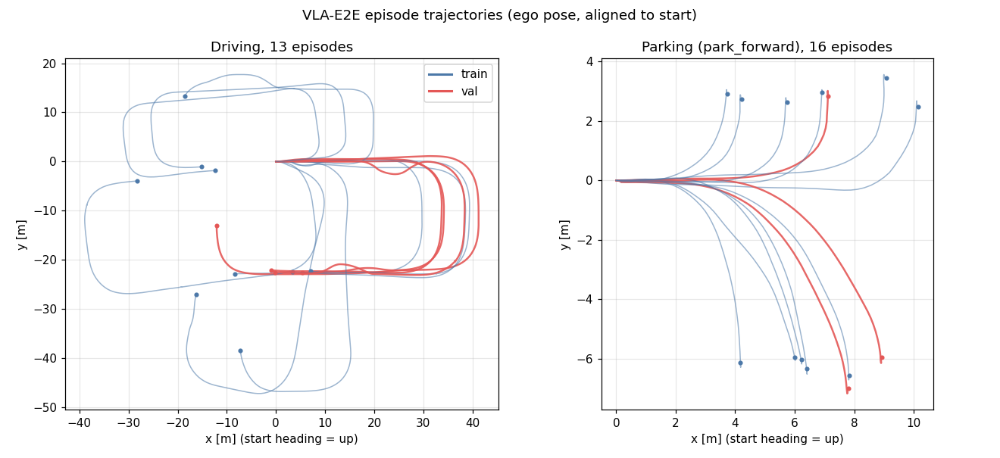

주행은 구내 순환로(사각 루프)를 여러 방향으로 돈 기록이고, 주차는 통로 직진 후 좌·우 주차면으로 약 90° 꺾어
들어가는 기록이다. Validation 주행(빨강)은 학습 주행과 같은 도로를 공유하므로 **장소 일반화는 평가하지 못한다.**

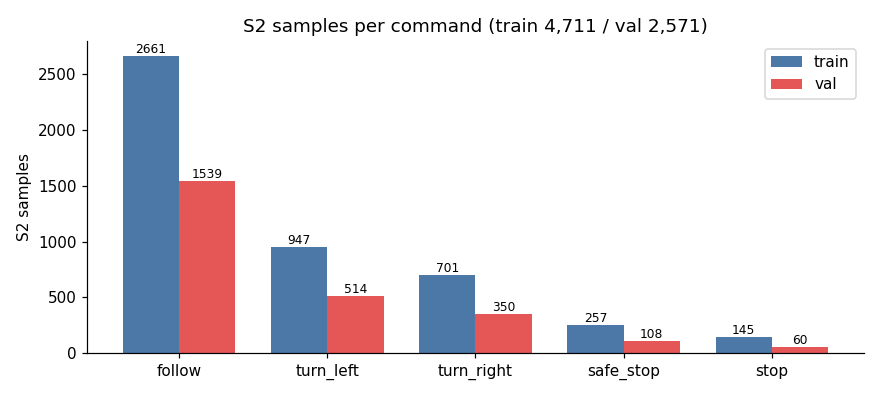

episode별 상세

| Episode | Split | 세션 | 프레임 | 시간(s) | 거리(m) | S2 샘플 |
|---|---|---|---:|---:|---:|---:|
| data1 | train | 0515 | 144 | 71 | 84 | 257 |
| data2 | train | 0519 | 182 | 90 | 91 | 303 |
| data5 | train | 0519 | 197 | 98 | 89 | 635 |
| data6 | train | 0515 | 160 | 79 | 83 | 603 |
| data7 | train | 0515 | 164 | 81 | 73 | 509 |
| data9 | train | 0515 | 150 | 74 | 86 | 550 |
| data10 | train | 0519 | 175 | 87 | 90 | 664 |
| data13 | train | 0521 | 195 | 97 | 98 | 602 |
| data17 | train | 0521 | 165 | 82 | 88 | 266 |
| data900–916 (13개) | train | 0519 park | 35–79 | 17–39 | 4–12 | 6–49 |
| data3 | val | 0515 | 159 | 79 | 85 | 575 |
| data8 | val | 0519 | 262 | 131 | 97 | 523 |
| data11 | val | 0515 | 171 | 85 | 103 | 789 |
| data12 | val | 0521 | 168 | 84 | 94 | 561 |
| data901 | val | 0519 park | 64 | 31 | 9 | 29 |
| data904 | val | 0519 park | 69 | 34 | 12 | 44 |
| data911 | val | 0519 park | 77 | 38 | 13 | 50 |

### 2.3 라벨 구성

- **Pixel-goal**: ego 궤적에서 약 5 m 앞 로컬 목표를 카메라로 재투영 → look-down 좌표계. (초기 라벨은 최종 목적지를 가리켜 S1 로컬 타깃과 불일치 → 재투영으로 수정)
- **명령**: 기록된 motion label(`follow/turn_left/turn_right`), 주차 episode는 `safe_stop`, 끝 프레임은 `stop`.
- **Safe-stop 지시문**: 주차면 영역(`target_region_id`)과 랜드마크 기반 설명을 사람이 검수(`target_description_reviewed`).
- **Temporal 입력**: 전방 history(최대 8장), safe_stop은 이전 look-down·이전 goal(prior).
- **S1 궤적**: 현재 프레임(s=0) 기준 4 waypoint, VLA-E2E→InternVLN 좌표축·스케일 정렬.

### 2.4 학습 샘플

같은 프레임에 여러 명령(실제 수행 명령 + 가능한 대안 명령)을 붙여 샘플을 만든다.

| 데이터 | Train | Val | 비고 |
|---|---:|---:|---|
| S2 대화 | 4,711 | 2,571 | follow 4,200 · left 1,461 · right 1,051 · safe_stop 365 · stop 205 |
| S1 궤적 | 4,442 | 2,446 | STOP 제외, 중복 command-goal window 124개 제외 |
| S2 v9 counterfactual 쌍 | 824 | – | 같은 영상·반대 명령 |
| S2→S1 goal cache | 4,442 | 2,446 | S2 v6 자유 생성, 전부 유효 좌표 |

## 3. 실험

### 3.1 단계별 경과

| 단계 | 기간 | 내용 |
|---|---|---|
| 0. Baseline | 2026-07 | 사전학습 InternVLA-N1-DualVLN(R2R 실내 학습)을 그대로 적용 → S2 goal median 839 px, 궤적 endpoint median 2.6 m |
| 1. S1 도메인 적응 | 07-17 ~ 08-03 | "예측 궤적이 항상 짧음"을 5개 원인으로 분리 수정 (아래 3.2) |
| 2. 명령 체계·S2 재학습 | 09 | 5종 명령, history 입력, 검수 랜드마크, safe_stop temporal prior (S2 v4→v9) |
| 3. S1 명령 조건 학습 | 09 ~ 10-09 | S2 예측 goal로 학습, 운동학 loss, endpoint 강화 (S1 v4→v9) |
| 4. 배포 | 10-09 ~ 10-21 | rc2 패키징, shadow replay, latency 분석, 비동기 런타임(rc3) |

### 3.2 도메인 적응 중 찾은 문제

| 문제 | 수정 |
|---|---|
| pixel-goal 라벨이 최종 목적지를 가리킴 | 로컬 5 m 목표로 재투영 |
| heading 채널 정규화가 R2R(0.1 m 간격) 기준 | VLA-E2E(1.0 m 간격) 스케일로 수정 |
| 좌/우 회전 8.5:1 불균형, theta 부호 버그 | 좌우반전 증강 + 부호 수정 |
| R2R 대비 xy 스케일 약 10배 차이 | 실측 스케일(0.4545)로 정렬 |
| 평가 시 파인튜닝된 vision encoder를 원본으로 덮어씀 | 로드 경로 수정 후 전면 재평가 |
| 학습/추론 프레임 불일치(goal 프레임 ≠ 현재 프레임) | s=0(현재 프레임) 기준 통일 (`S1_USE_FRAME_ALIGNMENT_FIX`) |

### 3.3 S2 버전

| 버전 | 핵심 변경 | 결과 |
|---|---|---|
| v4 | 5종 명령 + STOP | STOP 100%, 이후 val 구성 변경으로 수치 직접 비교 불가 |
| v5 | 검수된 주차면 랜드마크 지시문 | open median 66.9 px, safe_stop closed 831.6 px (틀린 prior에 고착) |
| **v6 (채택)** | bootstrap-robust: prior dropout 0.35, hard-negative prior, prior noise, safe_stop 반복 | open 68.4 px, **safe_stop closed 207.0 px** |
| v7 | 영문 canonical 지시문 | open 68.7 px, closed 296.5 px → 미채택 |
| v8 | 명령 temporal 입력 | open 70.3 px, closed ≤100 px 10.2% → 미채택 |
| v9 | 같은 장면 반대 명령 counterfactual 824쌍 | open **67.8 px**(최고), closed 218.2 px → 일반 주행 후보로 보존 |

학습: v6는 v5에서 3 epoch, batch 4, lr 1e-5, 좌우반전 0.5, safe_stop 반복 3(초기 프레임 12).

### 3.4 S1 버전

| 버전 | 핵심 변경 |
|---|---|
| v4 | 명령 조건 궤적 학습 |
| v5 | GT goal 대신 S2 예측 goal로 학습 |
| v6 | theta 정렬 |
| v7 | 운동학 loss(횡방향 consistency, reverse 억제), s=0 |
| v8 | S2 v6 예측 goal cache, endpoint loss, 후반 horizon 가중 |
| **v9 (채택)** | endpoint focus: v8에서 2 epoch, lr 5e-6, reverse 1.5, endpoint 1.0, 균형 sampling α 0.75 |

## 4. 정량 평가

### 4.1 Baseline vs 도메인 적응 (2026-08-03, val 125개)

| 지표 | Baseline(사전학습) | 적응 후 | 개선 |
|---|---:|---:|---:|
| S2 pixel-goal L2 median | 838.6 px | 77.2 px | −90.8% |
| S1 endpoint L2 median | 2.600 m | 0.807 m | −69.0% |
| S1 waypoint L2 median | 2.219 m | 0.282 m | −87.3% |

### 4.2 S2 (validation 2,571개)

Open-loop(이전 GT goal을 prior로 제공):

| 모델 | 전체 median | ≤100 px | Follow | Left | Right | Safe-stop | STOP 정확도 |
|---|---:|---:|---:|---:|---:|---:|---:|
| v5 | 66.9 | 65.8% | – | – | – | – | 100% |
| **v6** | 68.4 | 63.6% | 58.9 | 97.6 | 101.7 | 97.2 | 100% |
| v8 | 70.3 | 63.8% | 59.6 | 94.4 | 102.1 | 109.7 | 100% |
| v9 | 67.8 | 64.4% | 58.0 | 92.0 | 105.5 | 102.9 | 100% |

Safe-stop closed-loop(직전 예측을 다음 prior로, 주차 3 episode 108 프레임):

| 모델 | median | ≤100 px | 예측 점프 p95 |
|---|---:|---:|---:|
| v5 | 831.6 px | 5.6% | 87.5 px |
| **v6** | **207.0 px** | **20.4%** | 426.7 px |
| v7 | 296.5 px | 15.7% | 254.4 px |
| v8 | 207.4 px | 10.2% | 232.6 px |
| v9 | 218.2 px | 13.9% | 276.0 px |

- prior 없는 초기 3프레임 평균 오차 1,008.7 px → v6의 개선은 **초기 탐지가 아니라 틀린 prior에서의 회복**.
- 동일 장면 좌/우 지시 counterfactual: v6·v8·v9 모두 unseen 16쌍 **100%**(right 예측이 left보다 오른쪽), v9 held-in 32쌍 100%.
  (이전 보고서의 50%는 셔플된 예측과 GT를 잘못 연결한 평가 코드 버그였고 수정 후 재현되지 않음)

### 4.3 S1 (전체 validation 2,446개, S2 v6 자유 생성 goal, 후보 4개, 10 step, 고정 seed)

| 명령 | N | Mean-traj ADE | FDE | MinADE@4 | Bearing MAE | ≤10° | Reverse 후보 | Endpoint behind |
|---|---:|---:|---:|---:|---:|---:|---:|---:|
| Follow | 1,480 | 0.370 m | 0.651 m | 0.281 m | 6.6° | 94.8% | 2.6% | 0% |
| Turn left | 512 | 0.448 m | 0.840 m | 0.343 m | 7.0° | 93.0% | 4.1% | 0% |
| Turn right | 346 | 0.431 m | 0.817 m | 0.328 m | 5.2° | 86.1% | 3.4% | 0% |
| Safe stop | 108 | 0.594 m | 1.211 m | 0.461 m | 11.8° | **42.6%** | 4.4% | 0% |
| **전체** | 2,446 | **0.405 m** | **0.739 m** | 0.308 m | 6.7° | **90.9%** | 3.1% | 0.03% |

v8 대비(동일 프로토콜): ADE 0.685 → 0.405 m(−40.9%), FDE 1.331 → 0.739 m(−44.5%), bearing MAE 13.4° → 6.7°(−49.7%), ≤10° 54.4% → 90.9%.

### 4.4 S2 goal 지연 영향 (비동기 실행 근거, 공통 2,160개)

| goal 지연 | 0 s | 0.5 s | 1.0 s | 1.5 s | 2.0 s |
|---|---:|---:|---:|---:|---:|
| ΔADE | – | +0.002 m | +0.003 m | +0.006 m | +0.010 m |

goal을 좌우 반전해도 ADE +0.05 m(safe_stop ≈ 0) → **S1은 goal을 약하게만 사용**한다. 지연에 둔감한 이유이자, 지시문 기반 목표 선택이 궤적에 잘 반영되지 않는 원인.

### 4.5 배포 검증 (H200 ×2)

Recorded-sequence shadow test(val 7 episode, 813 요청, episode history·safe_stop prior 연속 유지):

- HTTP 오류 0, episode 변경 시 409 + STOP 계약 통과.
- 주행 goal median 44–106 px(오프라인과 동일 수준).
- **safe_stop median 203 / 245 / 1,177 px → gate 미통과.** data904는 지시문과 target 설명 불일치 의심.

Latency:

| 구성 | 제어 응답 p50 / p95 | 비고 |
|---|---:|---|
| 직렬 (rc2) | 1,420 / 1,478 ms | S2 전처리 372 + generate 610 + S1 409 ms |
| **비동기 (rc3, S2 GPU0 / S1 GPU1)** | **363 / 413 ms** | S2 약 936 ms 주기, goal 나이 p50 1.51 s |

비동기 2 Hz 재생에서 명령 유지 구간 trajectory 출력 95.8%, 명령 변경 직후 약 1 s는 goal 대기 STOP.

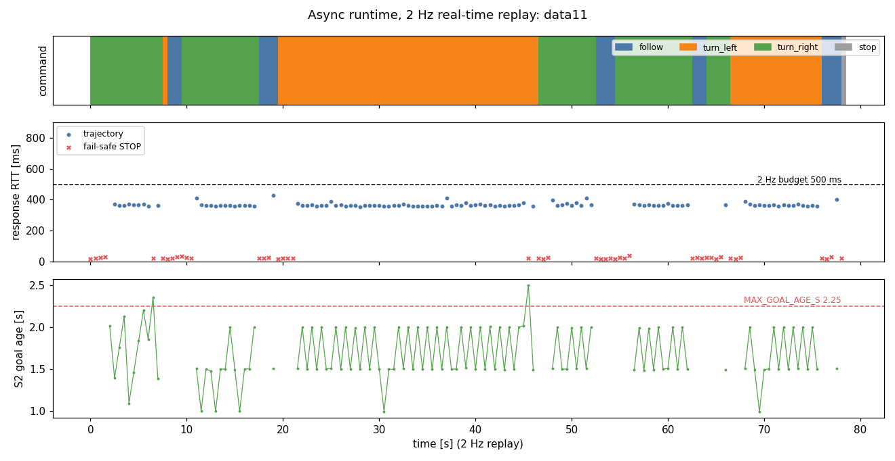

data11 실시간 재생. 응답(파랑)은 모두 500 ms 예산 안에 들어오고, 빨간 X(STOP)는 주행 시작과 명령이 바뀐 직후에만
몰려 있다. goal 나이는 S2 주기(약 0.94 s)와 2 Hz 프레임이 맞물려 1.0/1.5/2.0 s로 계단처럼 움직인다.

## 5. 정성 평가

### 5.1 Baseline vs 도메인 적응

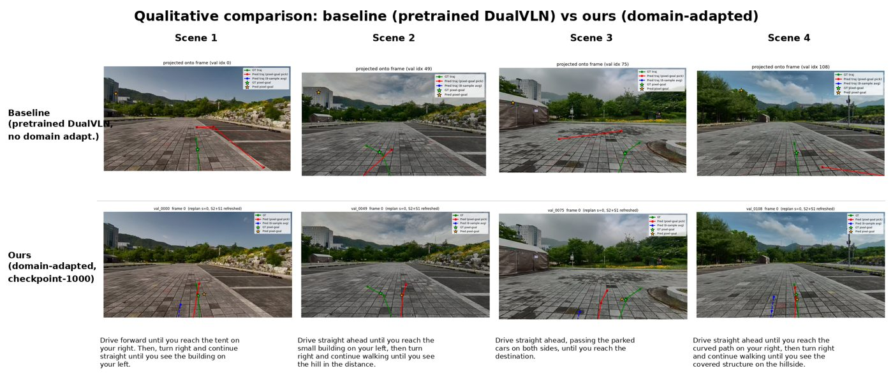

사전학습 모델(위)은 실내 R2R 습관대로 엉뚱한 방향·길이의 궤적을 낸다. 적응 후(아래)는 GT(녹색)를 따라 차선 방향으로 진행한다.

### 5.2 연속 주행 시퀀스 (rc3 런타임으로 새로 실행)

`tools/render_sequence.py`로 validation episode 전체를 프레임 순서대로 실제 런타임(S2 v6 + S1 v9, history·prior 유지)에
통과시킨 결과다. 주황 십자 = S2 goal, 노란 원 = GT goal, 연빨강 = S1 후보 4개, 자홍 = 제어 선택 궤적, 오른쪽 = 위에서 본 궤적.

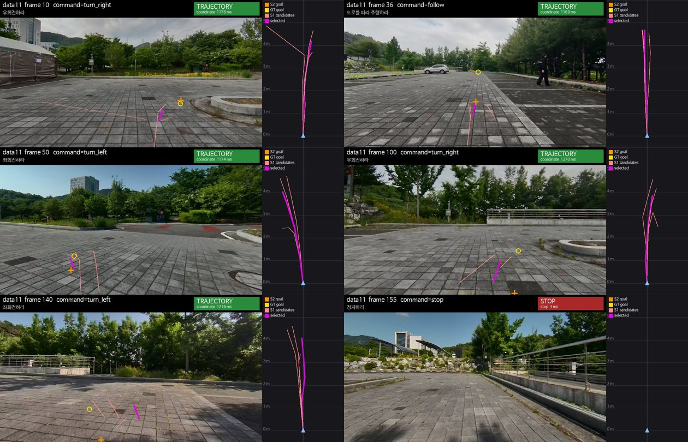

- data11(주행 157프레임): 156프레임 정상 궤적, 끝의 `stop` 명령 1프레임은 즉시 STOP(4 ms).
- 직진·완만한 곡선은 안정적이다. 회전 명령에서도 S1 궤적은 **4–5 m 앞까지 완만하게만 휜다**(끝점 횡이동 약 0.5–1.2 m).
  교차로처럼 큰 회전은 여러 주기에 걸쳐 조금씩 꺾는 방식이 된다.
- 회전 명령 중 S2 goal이 GT와 반대쪽에 찍히는 프레임이 있다(frame 100: goal이 아래쪽 화면 밖, 궤적은 약하게 우측).

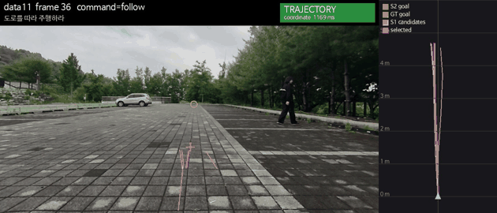

### 5.3 주차 시퀀스

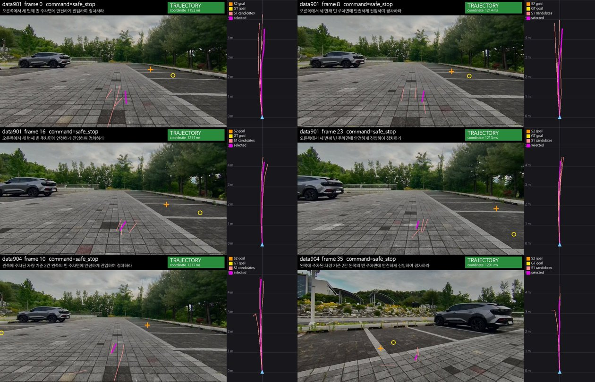

- data901 "오른쪽에서 세 번째 빈 주차면": S2 goal이 오른쪽 주차열의 GT 근처를 계속 추적한다(goal median 오차 203 px).
- 그러나 **S1 궤적은 거의 직진**한다(끝점 횡이동 평균 +0.12 m, heading 변화 9°). 실제 주차는 약 10 m 동안 90° 가까이 꺾어
  들어간다(2.2절 그림). goal이 옆에 있어도 S1이 그쪽으로 꺾지 않는 것이 정성적으로도 확인된다(4.4절 "goal 의존도 낮음"과 일치).
- data904 "왼쪽 차량 기준 2칸 왼쪽": 초반(frame 10)에 S2 goal이 **반대편(오른쪽) 주차열**에 찍힌다. 접근 후반(frame 35)에는 GT 근처로 온다.

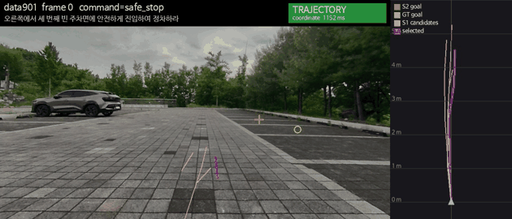

### 5.4 S2 pixel-goal (v6, median 사례)

| Follow | Turn left | Turn right |
|---|---|---|
| 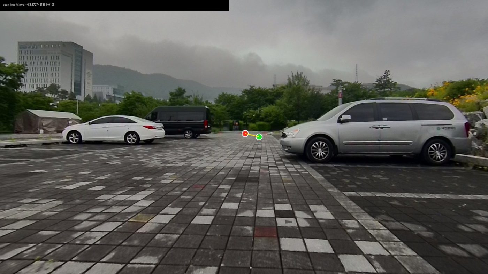 | 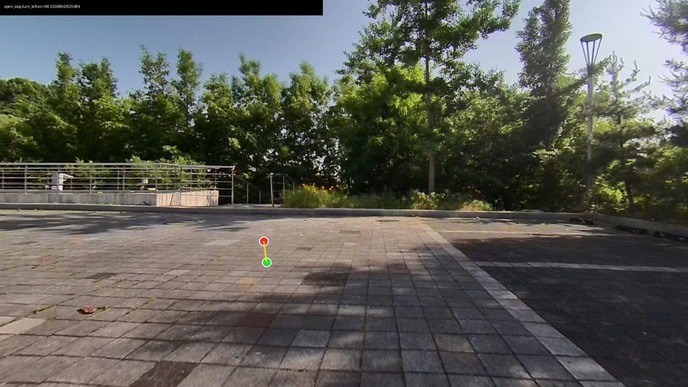 | 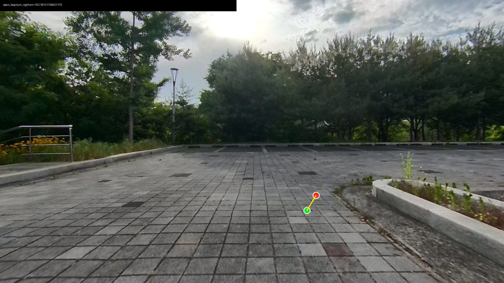 |

일반 주행은 진행 방향 노면 위 목표를 안정적으로 찍는다.

### 5.5 S2 safe-stop closed-loop

| Median | Worst (오차 1,832 px) |
|---|---|
| 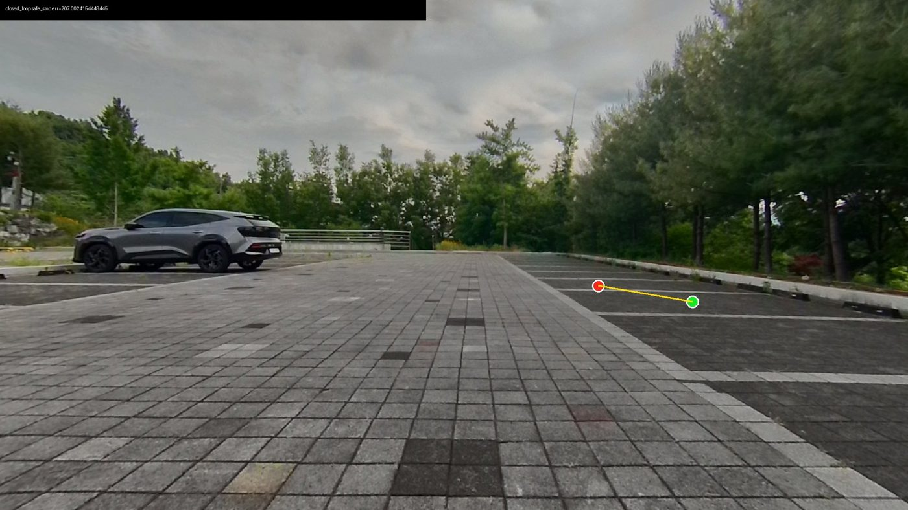 | 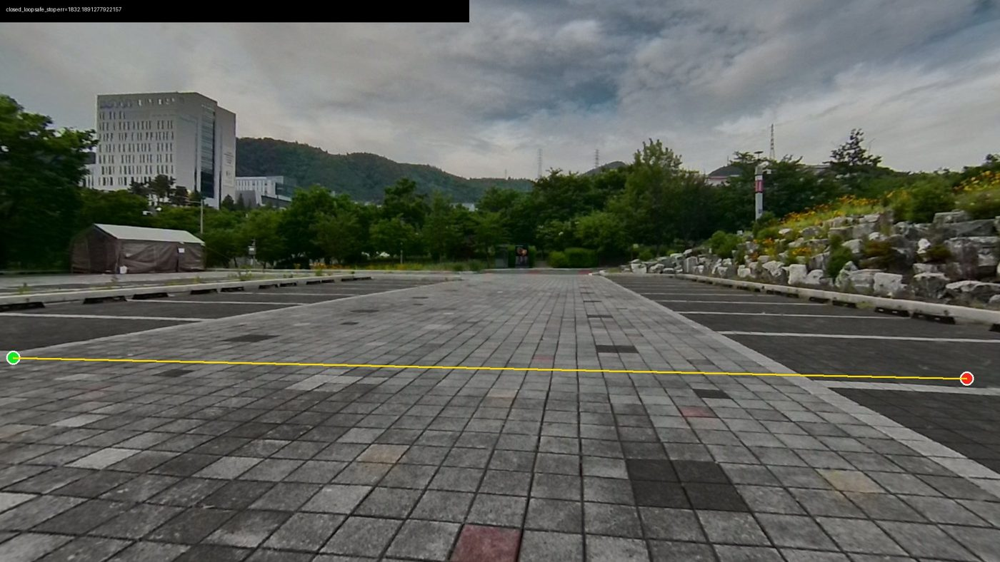 |

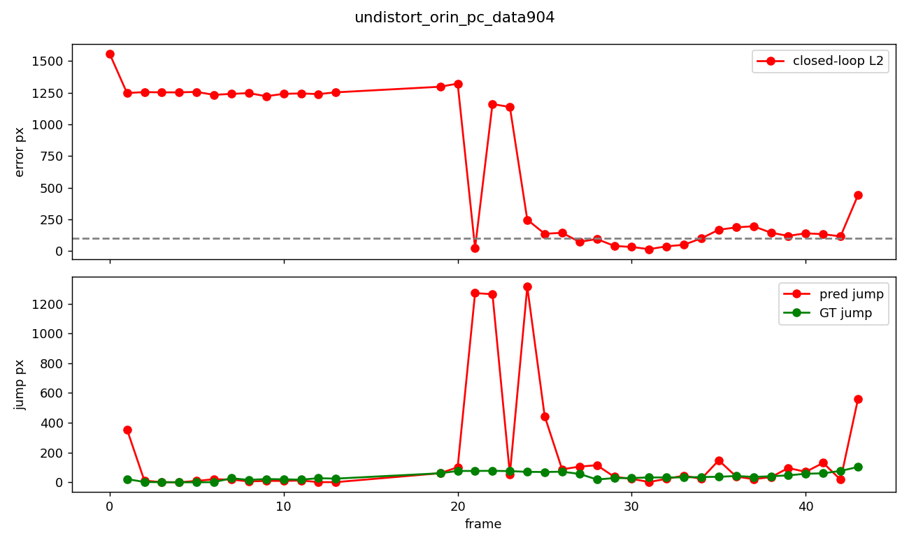

실패 유형: 지시한 주차면(녹색 GT, 왼쪽)이 아니라 **통로 반대편 주차열**(빨강 예측, 오른쪽)을 고른다. 시간축으로 보면 틀린 목표가 이어지다 한 번에 크게 점프한다.

### 5.6 동일 장면 좌/우 지시

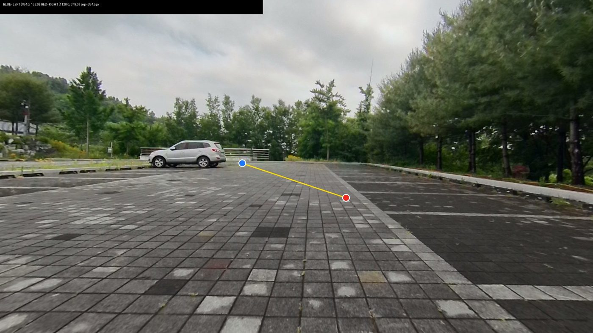

같은 영상에서 지시문만 left(파랑)/right(빨강)로 바꾸면 예측이 올바른 방향으로 갈라진다.

### 5.7 S1 궤적 (v9, median 사례)

| Follow | Turn left |
|---|---|
| 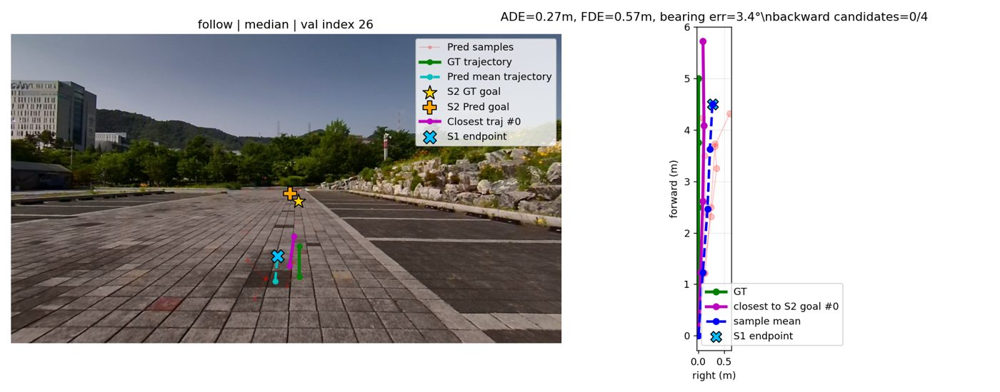 | 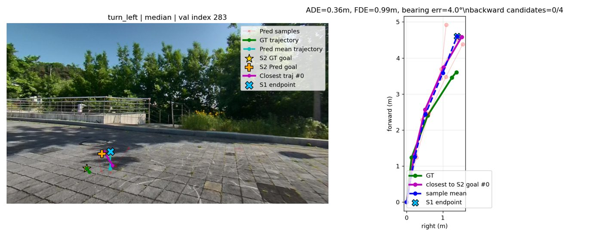 |
| **Turn right** | **Safe stop** |
| 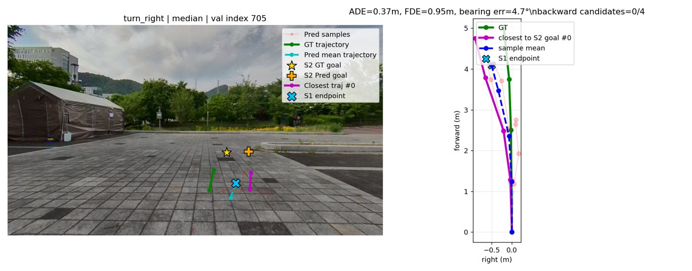 | 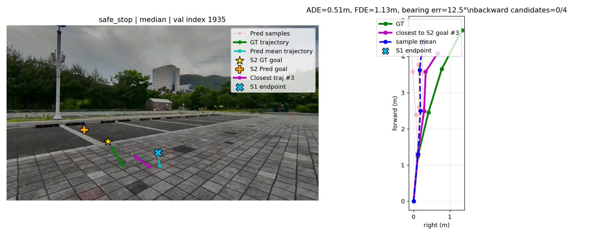 |

녹색 GT, 연빨강 후보 4개, 파랑 평균, 자홍 S2 goal에 가장 가까운 후보. 주행 명령은 GT와 거의 겹치고 후진 후보가 없다.

### 5.8 S1 실패 사례 (safe_stop worst, ADE 1.53 m)

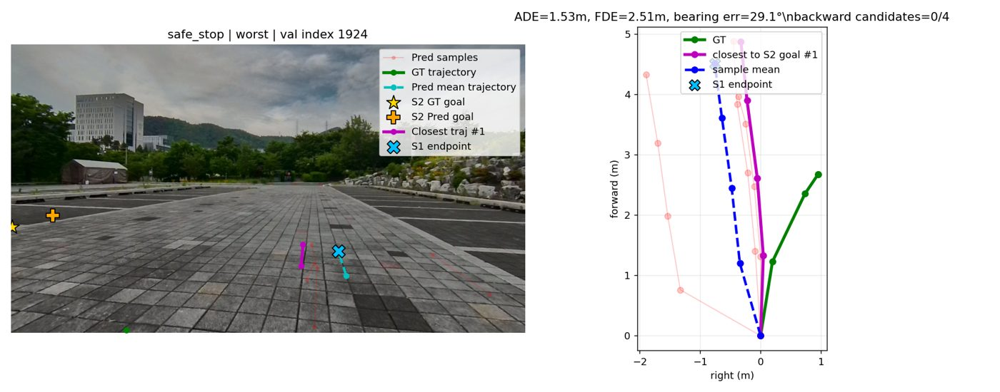

GT는 오른쪽 주차면으로 꺾지만 후보는 직진~좌측으로 퍼진다. S2 goal(주황)도 화면 왼쪽 끝으로 틀렸고, S1은 그 goal도 따라가지 않는다 → S2 grounding과 S1 goal conditioning이 동시에 약한 사례.

## 6. 결론과 한계

| 항목 | 판단 |
|---|---|
| 일반 주행 pixel-goal (S2) | 사용 가능 수준 |
| STOP 분류 | validation 100% |
| 일반 주행 궤적 (S1) | ADE 0.4 m, bearing ≤10° 91–95% |
| safe_stop 목표 grounding | **미달** — 반대편 주차열 선택, 초기 탐지 약함 |
| safe_stop 궤적 | 주차면 쪽으로 꺾지 못하고 거의 직진(연속 재생 확인), ≤10° 42.6% |
| 실시간성 | 비동기로 2 Hz 충족 |
| 실차 폐루프 | **미검증** — shadow mode 전용 |

한계:

1. 데이터 규모가 작다(27분, 1.3 km, 단일 구내). 장소·날씨·교통 다양성이 없다.
2. 주차 validation은 3 episode / 108 프레임으로 표본이 작다.
3. 모든 S1 평가는 open-loop(기록 영상 재생)이다. 차량 움직임이 다음 입력에 반영되는 폐루프는 실차 또는 시뮬레이터가 필요하다.
4. S1이 goal을 약하게 사용하므로 지시문 기반 목표 변경이 궤적에 충분히 반영되지 않는다.

다음 과제: safe_stop S2 grounding(초기 탐지·반대편 주차열 구분), S1 goal conditioning 강화, 데이터 확대(장소·주차 시나리오), 폐쇄구역 저속 실차 검증.

## 부록: 원본 결과 위치 (학습 서버)

| 항목 | 경로 (`vla_project/outputs/`) |
|---|---|
| 통합 평가 (2026-09-30) | `FINAL_S1_S2_EVALUATION_REPORT_KO.md` |
| S2 v9 평가 | `S2_V9_EVALUATION_REPORT_KO.md` |
| S1 v9 지표 | `eval_s1_e2e_v9_endpoint_focus_full_val/metrics.json` |
| goal 지연 평가 | `async_goal_lag_s1v9/REPORT_KO.md` |
| Shadow test | `shadow_test_rc2_20261020/SHADOW_TEST_REPORT_KO.md`, `shadow_test_async_20261020/REPORT_KO.md` |
